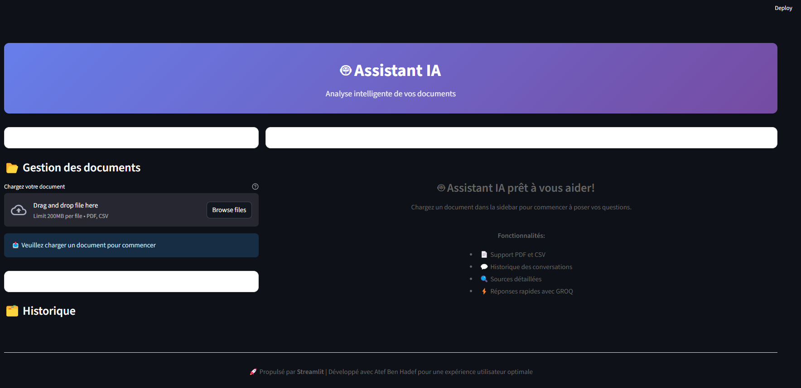
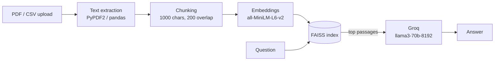

<div align="center">

# 🧠 Assistant IA — Chat with your PDF and CSV files

**A Retrieval-Augmented Generation (RAG) app: upload a document, ask questions in natural language, get answers grounded in its content.**




</div>

---

## How it works



1. **Extract** the text of the uploaded PDF or CSV.
2. **Split** it into overlapping chunks with LangChain's `CharacterTextSplitter`.
3. **Embed** the chunks locally with `sentence-transformers/all-MiniLM-L6-v2` and index them in **FAISS**.
4. **Retrieve** the passages closest to the question and send them to **LLaMA 3 70B on Groq** (temperature 0.2), asked to answer from the provided documents.

## Features

- PDF and CSV ingestion
- Local semantic search (no embedding API cost)
- Conversational Streamlit interface with a custom theme
- API key kept in a `.env` file, never committed

## Quick start

```bash
git clone https://github.com/atef-hadef/Assistant_IA.git
cd Assistant_IA
python -m venv .venv && source .venv/bin/activate     # Windows: .venv\Scripts\activate
pip install -r requirements.txt
```

Create a `.env` file with your [Groq API key](https://console.groq.com/keys):

```bash
GROQ_API_KEY=your_key_here
```

```bash
streamlit run main.py
```

## Project structure

```
Assistant_IA/
├── main.py            Streamlit interface
├── assistant.py       RAG functions: extraction, chunking, vector store, Groq call
├── images/            screenshots
├── requirements.txt
└── .env               local secrets (git-ignored)
```

## Limitations and next steps

- The answer is not returned with source citations yet.
- Chunking is character-based; a recursive or semantic splitter would respect structure better.
- No automated tests or evaluation set.
- The follow-up project [NeuralDoc](https://github.com/atef-hadef/neuraldoc) adds an API, persistence, tests and CI.

## Author

**Atef Ben Hadef**: [GitHub](https://github.com/atef-hadef) · [LinkedIn](https://linkedin.com/in/atef-ben-hadef)
